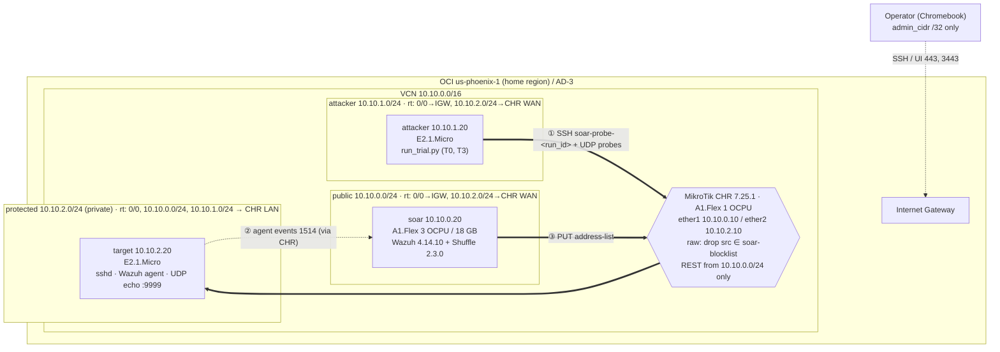
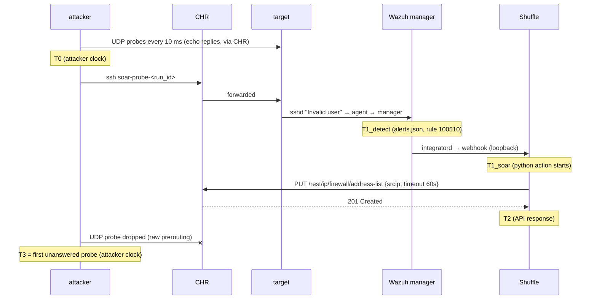

# Diagram specs (shared by en.md / ja.md)

Two formats of the same diagrams:

| Diagram | Mermaid (below) | draw.io |
|---|---|---|
| §1 OCI topology | ✅ | [`diagrams/oci-topology.drawio`](diagrams/oci-topology.drawio) |
| §2 T0–T3 measurement flow | ✅ | [`diagrams/e2e-sequence.drawio`](diagrams/e2e-sequence.drawio) |

The `.drawio` files are generated by `diagrams/gen_drawio.py` (stdlib only); edit the script and re-run
rather than hand-editing, so both formats stay in sync. Labels are English in source; translate in
the rendered JA version. Only private addresses and role names appear — no public IPs, OCIDs or secrets.

## §1 OCI topology (as deployed, `chr_mode = dual-nic`)

Notes for the article text:
- CHR's two VNICs have `skip_source_dest_check = true`; every route that steers traffic to CHR targets its private-IP OCID.
- Return traffic is forced through CHR by more-specific intra-VCN routes on the protected subnet (symmetric path).
- Wazuh → Shuffle is a loopback call on soar (`127.0.0.1:5001`); nothing in the control path leaves the VCN.

## §2 T0–T3 measurement flow

Segments: D_detect = T1_detect − T0 · D_dispatch = T1_soar − T1_detect · D_api = T2 − T1_soar ·
D_enforce = T3 − T2 · **D_e2e = T3 − T0** (T0 and T3 are taken on the same clock).

## §3 Result charts

Generated from the raw data by `experiments/01-e2e-latency/scripts/plot_results.py` — see [`figures/README.md`](figures/README.md).

- `figures/fig1-segments.svg`: stacked bars, mean time per segment and condition
- `figures/fig2-e2e-cdf.svg`: empirical CDF of E2E per condition
